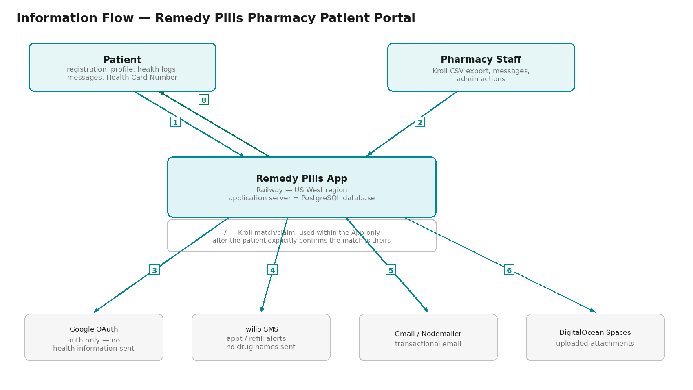

# Privacy Impact Assessment — Remedy Pills Pharmacy Patient Portal

**Prepared under Alberta's Health Information Act (HIA), section 64, for submission to the
Office of the Information and Privacy Commissioner (OIPC) of Alberta.**

This document follows the mandatory structure and headings set out in the OIPC's
*Privacy Impact Assessment Requirements* (HIA). It is submitted to **pia@oipc.ab.ca** together
with a signed cover letter and the Section E policy attachment.

Everything describing what the system does, what data it collects, and what technical
safeguards exist has been drawn directly from the application's source code and configuration
as of 2026-08-31.

This PIA is being submitted before the App is placed into live operation. As of the submission
date: the App is listed for testing purposes only (internal/closed testing) and contains no
patient data; no patient information has been captured or entered into the App or the patient
portal; and Kroll has not been connected to the App, and no information has been pulled from
Kroll. Accordingly, this document describes the system as designed and built. Every statement
below describing what the App "does" should be read as describing what it is built to do once
it is in live operation, not as a description of processing already occurring against real
patient information. The pharmacy will not place the App into live use or connect it to Kroll
until this review is complete.

The App's privacy policy previously stated that health records are stored in Canada. That
statement has since been corrected: the database and application server are hosted by Railway
in its US West region, as disclosed in Section C.7. The pharmacy has decided to retain this
hosting arrangement, and is putting in place the contractual safeguards the Health Information
Regulation requires for storage outside Alberta, as described in Section C.6.

---

## COVER LETTER

A signed cover letter accompanies this submission as a separate document
(*Remedy Pills Pharmacy — PIA Cover Letter*).

---

## COVER PAGE

| Field | Value |
|---|---|
| **Official Project Name** | Remedy Pills Pharmacy Patient Portal (mobile app + web application) |
| **Other names used** | "RemedyPills," `ca.remedypills.app` |
| **Legal Name of Custodian** | "Remedy Pills Inc.," operating as Remedy Pills Pharmacy |
| **Person completing this PIA (OIPC's primary contact)** | Adeel Siddiqui, Proprietor — 403-390-2634; remedypillspharmacy@gmail.com |
| **Person responsible for HIA compliance ("responsible affiliate" — HIA s.62)** | Nayel Anwer, Pharmacy Manager / Privacy Officer — remedypillspharmacy@gmail.com, +1 403-980-7003 |
| **PIA submission date** | September 9, 2026 |
| **Expected/actual implementation date** | **Not yet in live operation.** The App is currently in testing only, with no patient data. Go-live date is to be determined, following the OIPC's review of this PIA. The Kroll import feature is built but has not been connected to Kroll or run against any real data. |
| **OIPC file references for related prior PIAs** | None on file. |

---

## SECTION A — PROJECT SUMMARY

*(This section is published in the OIPC's public PIA Registry.)*

**1. What does the system do?**

The Remedy Pills Pharmacy Patient Portal is a mobile app (Android, published on Google Play
as `ca.remedypills.app`; iOS in development) and companion web application that lets
patients of Remedy Pills Pharmacy (Calgary, Alberta):

- View and request refills of their prescriptions
- Set personal medication reminders
- Book and manage pharmacy service appointments (consultations, injections, medication
  reviews)
- Exchange secure messages with the pharmacy (currently handled exclusively by the Pharmacy Manager, Nayel Anwer)
- Log personal health measurements and food/calorie intake
- Manage family members' prescriptions where they hold caregiver authority
- Submit a prescription transfer request from another pharmacy
- **(Built, not yet enabled in production — no Kroll data has been imported) Link their provincial Health Card Number and/or confirm a name +
  date-of-birth match to import their existing medication history from the pharmacy's Kroll
  dispensing system into their profile**, with explicit patient confirmation required before
  anything is copied

Pharmacy staff use an administrative console within the same system to manage patient
records, respond to messages, send broadcast notifications and SMS, manage promotional
content, and — for the Kroll import feature, once enabled — upload a CSV export from Kroll (not yet used against any real data).

**2. Business rationale**

The App reduces phone-call volume for routine pharmacy interactions (refills, appointment
booking, status questions) and gives patients a persistent record of their own medications
and appointments. The Kroll import feature specifically addresses new patients who are
transferring to Remedy Pills Pharmacy or existing patients who have not previously used the
App: rather than re-entering their medication history by hand, they can have it populated
from the pharmacy's own dispensing records, subject to their explicit confirmation that the
record shown is theirs.

**3. Key players**

- **Custodian:** Remedy Pills Pharmacy (Nolan Hill, Calgary, AB), licensed under the Alberta
  College of Pharmacy.
- **Patients:** individuals with an account, who are current or prospective patients of the
  pharmacy.
- **Pharmacy staff / administrators:** pharmacists and pharmacy technicians with
  administrative access to the App, and to Kroll (the pharmacy's system of record for
  dispensing).
- **Hosting/technology vendors** (see Section C.6 for the full list and current agreement
  status): Railway (application hosting and database), Google (authentication, Google Play
  distribution), Twilio (SMS), Google/Gmail (transactional email), DigitalOcean (file/image
  storage for uploaded attachments).

**4. Where is health information stored/accessed?**

The system's database and application server currently run in Railway's **US West** region
— see the note under Section C.7. Uploaded files (e.g. patient-submitted images/PDFs) are
stored in DigitalOcean Spaces object storage; region to be confirmed (see Section C.7).
Staff access the App's administrative console and Kroll separately; Kroll itself is a
locally/vendor-hosted dispensing system not covered by this PIA except as a source of data
described in Section C.5.

**5. Why does the project need to collect, use, or disclose health information?**

Health information (prescription details, medication history, appointment records, health
measurements, and messages with pharmacy staff) is the core content the App exists to manage
on the patient's behalf, as part of the pharmacy's delivery of pharmacy services. The Kroll
import feature specifically needs to *use* existing dispensing records (already lawfully held
by the pharmacy as custodian) by copying a patient's own medication history into their App
profile, only after the patient — who is the subject of that information — has confirmed it
is theirs.

---

## SECTION B — ORGANIZATIONAL PRIVACY MANAGEMENT

**1. Management structure**

Remedy Pills Pharmacy is a locally owned and operated community pharmacy. The Pharmacy
Manager is responsible for the day-to-day management of privacy and the protection of
personal and health information collected, used, maintained, and disclosed by the pharmacy.
Nayel Anwer, Pharmacy Manager, is designated as the **Privacy Officer** and is accountable
for privacy-related decisions, including responding to privacy inquiries and complaints,
overseeing compliance with applicable privacy legislation and professional requirements,
managing privacy incidents, and coordinating with the pharmacy owner on material issues.

As a small community pharmacy, Remedy Pills Pharmacy does not maintain a separate privacy
committee. Privacy matters are managed through the Pharmacy Manager/Privacy Officer, with
significant privacy incidents, compliance concerns, or matters requiring business-level
decisions escalated to the pharmacy owner. Where third-party service providers, technology
vendors, or application providers are involved in processing personal information, the
Pharmacy Manager is responsible for ensuring that appropriate privacy and contractual
requirements are considered. Full detail: **Appendix E-1 §2 (Privacy Accountability)**.

**2. Policy management**

Remedy Pills Pharmacy is responsible for establishing and maintaining privacy policies and
procedures appropriate to the operations of a community pharmacy and the sensitivity of the
personal and health information handled by the organization. Policies are developed based
on applicable Alberta privacy and health-information requirements, pharmacy regulatory
obligations, operational requirements, and identified privacy risks, and are communicated to
staff during onboarding and through ongoing training and updates when requirements change.
Policies are reviewed at least annually, and additionally whenever there is a significant
change to legislation, operations, technology, vendors, or identified risks. Full detail,
including the complete set of written policies: **Appendix E-1** (the *Privacy & Information
Security Policy Manual*, attached at Section E of this PIA).

**3. Training and awareness**

Remedy Pills Pharmacy recognizes that privacy protection is a shared responsibility among all
pharmacy staff, administrators, contractors, and other individuals who may have access to
personal or health information. Privacy and confidentiality requirements are addressed during
staff onboarding and orientation, covering (as applicable) protection of patient information,
collection/use/disclosure rules, secure handling of records and communications, appropriate
system access, password/account security, privacy considerations for electronic
communications, identifying and reporting suspected incidents, responding to patient privacy
inquiries, and confidentiality obligations toward third-party providers. The Pharmacy
Manager/Privacy Officer oversees training and ensures refresher training is provided at least
annually. Full detail: **Appendix E-1 §5 (Training, Awareness & Sanctions)**.

**4. Incident response**

Partially implemented in the system itself: every sensitive action (Health Card Number
linked/unlinked, a linking conflict blocked, Kroll data uploaded/deleted, a Kroll match
claimed or declined, an account password changed, an account deleted, admin actions on
patient records) is written to an append-only audit log (`audit_logs` table) with the
acting user, action, detail, timestamp, and IP address. The written incident-response
*policy* — who is notified, decision criteria for notifying affected patients or the OIPC,
containment, evidence preservation, and post-incident review — is now documented in
**Appendix E-1 §19 (Incident Response)**, attached at Section E of this PIA.

**5. Access and correction requests**

Patients can view their own health information at any time by logging into the App
(prescriptions, appointments, health logs, messages are all patient-scoped by design — a
patient can only query their own records; see Section D.1). Patients can update their own
name, email, phone, date of birth, and Health Card Number directly (`PATCH /api/profile`).
Corrections to clinical data itself (e.g. a prescription's directions) are made by pharmacy
staff through the admin console. The formal process and timeframe for handling patient access
and correction requests — including identity verification, response timelines, and
documentation — is set out in **Appendix E-1 §3 (Access to Health Information) and §4
(Correction Requests)**.

---

## SECTION C — PROJECT PRIVACY ANALYSIS

### C.1 Health Information Listing

| Category | Data elements | Unique identifiers? |
|---|---|---|
| Registration / identity | Name, username, email, phone, date of birth, password (hashed, never stored in plain text) | Name + DOB combination; email; phone |
| **Health Card / Personal Health Number** *(new)* | Patient-entered provincial Health Card Number, stored digits-only, unique per account | **Yes — a real unique identifier** |
| Prescriptions | Drug name, strength, directions, Rx number, status, last fill date, refill count/auto-refill flag, optional linked family member | Rx number |
| Medication reminders | Medication name, scheduled time, frequency, taken/snoozed status | — |
| Appointments | Service type, date/time, status, pharmacist notes, patient notes | — |
| Messages | Free-text message content between patient and pharmacy staff, sender, timestamp, category | — |
| Health logs | Type of measurement, value, secondary value, unit, notes, timestamp | — |
| Calorie/food logs | Meal type, food items, calorie/macro estimates, optional photo, notes | — |
| Family members | Name, relationship, date of birth, caregiver's attestation of authority | — |
| **Kroll staged import data** *(new — see C.5)* | Patient name, DOB, Health Card Number (if present in the Kroll export), drug name, strength, directions, Rx number, last fill date | Health Card Number where present |
| Notifications | Type, title, body text, read status | — |
| Audit log | Acting user, action taken, free-text details, IP address, timestamp | — |
| Session data | Server-side session token, expiry | — |

### C.2 Information Flow Analysis

**Component 1 — Information Flow Diagram**

*Flows 1–8 in the diagram above correspond exactly to the numbered rows in Component 2 below.*

**Component 2 — Purposes and Legal Authority**

| # | Flow | Type of information | Purpose | Legal authority |
|---|---|---|---|---|
| 1 | Collection directly from patient (registration, profile edits, health logs, messages, Health Card Number) | Registration + health information | To provide the App's pharmacy-service features to the patient | Collection — HIA ss.18–24 |
| 2 | Collection from pharmacy staff (Kroll CSV upload) | Patient name, DOB, HCN, medication history | To populate a staging area from which a matching patient may import their own history | Collection — HIA s.20 (custodian already holds this information as dispensing records); indirect collection where staff act on the custodian's behalf |
| 3 | Disclosure to Google (OAuth) | Name, email (profile only — no health information) | Authentication | Use/Disclosure — limited to non-health identity data; no health information is sent to Google |
| 4 | Disclosure to Twilio | Phone number, minimal appointment/refill status text (no diagnosis or drug names sent by SMS) | SMS notification | Disclosure — HIA s.27/35(1)(a) use/disclosure for provision of health services, minimized per app design |
| 5 | Disclosure to Gmail/Google (nodemailer) | Email address, transactional content (appointment/prescription status) | Transactional email | Disclosure — same basis as above |
| 6 | Disclosure to DigitalOcean Spaces | Uploaded attachments (e.g. prescription images) | Storage of patient-submitted files | Use — Information Manager arrangement (HIA s.66) — **written agreement status to be confirmed, see C.6** |
| 7 | Use within the App — Kroll match/claim | Medication history (drug name, strength, directions, Rx number, fill date) | Copied into the patient's own prescriptions **only after the patient explicitly confirms the match is theirs** | Use — HIA ss.25–30; patient confirmation additionally documented in the audit log |
| 8 | Disclosure back to patient (in-app display) | All of the above, patient's own record only | Ongoing care / the patient viewing their own information | HIA s.33 |

### C.3 Notice

The App's `/privacy` page (linked from the app and required at Play Store submission) states
what information is collected and why, in patient-facing language, and names a Privacy
Officer and contact details. The notice reflects the corrected, cross-border hosting
disclosure described in Section C.7. A description of the Kroll import feature will be added
to the notice before that feature is enabled in production.

### C.4 Consent and Expressed Wishes

- **Account-level consent:** patients affirmatively check a consent checkbox at registration
  ("I consent to Remedy Pills Pharmacy storing my health information and managing my
  prescriptions electronically"), timestamped (`consentGiven`, `consentDate`), and can
  withdraw consent at any time (`POST /api/consent/withdraw`), which is itself audit-logged.
- **Kroll import specifically requires a second, separate, explicit action:** finding a
  possible match (by name+DOB passively, or by Health Card Number when the patient enters
  it) **never** copies anything into the patient's record on its own. The patient is shown
  only a summary — name, DOB, and a medication *count*, never the actual drug list — and
  must click "Yes, that's me" before any medication data is copied in. Declining is recorded
  in the audit log for HIA accountability. This is intentionally more protective than the
  HIA's general consent-not-required-for-care-purposes rule, because the risk of a
  false-positive name/DOB match (two different people sharing both) is a real, if narrow,
  privacy risk — see Section D.2.

### C.5 Data Matching

**Yes — this project performs data matching within the meaning of HIA ss.70–71**, and this
PIA is submitted in part to satisfy that requirement, in addition to section 64.

The Kroll import feature combines two sets of health information: (1) medication/dispensing
records exported from Kroll and staged in the App's database, and (2) a patient's own
account information (name, date of birth, and optionally their self-entered Health Card
Number). Matching occurs two ways:

1. **Passive name + DOB matching** — on every login, the App checks whether any unclaimed
   staged Kroll record matches the logged-in patient's own name and date of birth exactly
   (normalized for case/spacing/punctuation). If so, a banner offers to show them the match.
2. **Patient-initiated Health Card Number matching** — a patient may enter their Health Card
   Number, which the server checks against staged Kroll records sharing that number. This is
   the stronger match path, since a Health Card Number is a genuine unique identifier
   unlike name+DOB, which can collide between two people.

**Privacy risk specific to this matching:** because name+DOB is not a guaranteed-unique
identifier, an unlikely name+DOB collision between two different patients could cause a
patient to see a banner confirming that *someone* matching their name and birthdate has
medication records at the pharmacy, even before they click "Yes, that's me" — which is
itself a narrow disclosure (that a health relationship exists) though it never discloses
the actual medications. This risk is mitigated by (a) requiring explicit confirmation
before anything is copied, (b) the stronger Health Card Number path being available and
encouraged, and (c) both a match shown and a match declined being audit-logged. See
Section D.2 for the full risk/mitigation entry.

### C.6 Contracts and Agreements

| Vendor | Role | Data it can access | Information Manager Agreement (HIA s.66) on file? |
|---|---|---|---|
| **Railway** | Application hosting, PostgreSQL database (all patient/health data at rest) | Full database access as the underlying infrastructure provider | Not currently in place. If the OIPC's review of this PIA determines a written IMA is required, the pharmacy will initiate one with Railway before connecting real patient data. |
| **Google** | OAuth authentication; Google Play distribution | Name, email (auth only) — no health information | Governed by Google's standard terms, not a custom IMA — no health information is in this flow. |
| **Twilio** | SMS delivery | Phone number, message text (minimized — no drug names) | Governed by Twilio's standard commercial terms, not a custom IMA — no health information is in this flow. |
| **Google (Gmail/nodemailer)** | Transactional email | Email address, message content | Governed by Google's standard terms, not a custom IMA — no health information is in this flow. |
| **DigitalOcean** | Object storage for uploaded attachments | Uploaded files (may include prescription images) | Not currently in place. Same position as Railway: to be initiated if required, before connecting real patient data. |
| **TELUS Health (Kroll)** | Pharmacy's dispensing system of record; source of the CSV exports staff upload | N/A — Kroll does not receive data *from* the App; the App only imports from Kroll | Not an information manager *for this project* — Kroll is the pharmacy's own separate system. |

Written Information Manager Agreements are not yet in place with Railway or DigitalOcean, the
two vendors that hold patient data at rest. The pharmacy's position is that it will initiate an
Information Manager Agreement with the relevant vendor(s) if the OIPC's review of this PIA
determines one is required, and will do so before any real patient data is connected. Google,
Twilio, and Gmail flows carry no health information and are correspondingly lower risk (see
table above). See also Appendix E-1 §10 (Third Parties & Information Managers).

### C.7 Use of Health Information Outside Alberta

**Verified fact, disclosed here and now reflected in the App's privacy policy:**

The application server and PostgreSQL database are hosted on Railway in the **US West**
region (confirmed directly in Railway's console: the database's proxy endpoint is
`sakura.proxy.rlwy.net`, tagged "US West"; the application server shows the same region
tag). **All health information described in Section C.1 — including the new Health Card
Numbers and Kroll-imported medication history — will therefore be stored in the United
States, not in Alberta or elsewhere in Canada, once the App is live and begins holding
patient data.**

**Decision (2026-09-01): the pharmacy is keeping US hosting for now, not migrating to a
Canadian region.** Railway does not currently offer one in any case — its available regions
are US West, US East, EU West (Amsterdam), and Southeast Asia (Singapore); moving to Canadian
residency would require switching providers entirely (e.g. AWS ca-central-1, Azure Canada
Central/East, GCP northamerica-northeast1/2), which was considered and deferred.

The App's public privacy policy has accordingly been corrected — it previously stated the
opposite, that records were "stored within Canada," which was inaccurate — to instead
disclose: "Our pharmacy records are currently hosted with a cloud infrastructure provider
located outside of Canada. We remain fully responsible for this information regardless of
where it is hosted, require our hosting provider to protect it accordingly, and are working
to store pharmacy records within Canada."

Storage outside Alberta is permitted under the HIA, but requires the extra measures
described in the *Health Information Regulation*, and the custodian's agreement with the
out-of-province provider (Railway) must contain the specific contractual language the
Regulation requires. This contractual language is not yet in place with Railway; putting it
in place is the pharmacy's path to compliance for this section, described further in
Section C.6.

The object storage for uploaded attachments (DigitalOcean Spaces) has a separately
configured region (`SPACES_REGION` environment variable) that has not been separately
confirmed as part of this review.

Twilio, Google, and Gmail are also US-domiciled global services; email and SMS content is
minimized (no drug names or diagnoses are sent by SMS or email) but transits US
infrastructure, consistent with how most Alberta virtual-care technology currently operates.

---

## SECTION D — PROJECT PRIVACY RISK MITIGATION

### D.1 Access Controls

| Position / Role | Number of staff in role | Type of access | Description of information this role can access |
|---|---|---|---|
| Patient | 1 *(an internal test account created during development, not a registered patient — see the note on the App's current status at the beginning of this PIA)* | Read/write, own records only | Own registration data, prescriptions, appointments, messages, health logs, Health Card Number. Enforced server-side: every patient-facing query and mutation is scoped to `req.user!.id`; a patient cannot query another patient's records by guessing an ID. |
| Admin (pharmacist/pharmacy manager) | 1 — the Pharmacy Manager (Nayel Anwer) is currently the only individual with an Admin profile; see Appendix E-1 §17 | Read/write, all patients | Full read/write access to all patient records, messaging, Kroll CSV upload, broadcast notifications/SMS, promotional content, audit log. Gated by `requireAdmin` middleware — checked server-side on every admin route, not just hidden in the UI. |
| Unauthenticated visitor | N/A | None (except public routes) | Only the public marketing/privacy pages, the promo banner, and the public prescription-transfer / contact-webhook intake forms (rate-limited). No health information is accessible without authentication. |

**Authentication:** password-based (scrypt with random salt, timing-safe comparison — not a
fast/weak hash) or Google OAuth (native SDK on mobile, redirect flow on web); account lockout
after 5 failed attempts; session cookie backed by a server-side Postgres session store, not a
client-trusted token.

**Termination of access:** The Pharmacy Manager is currently the only individual with an
Admin profile; staff members do not have administrative access. If the Pharmacy Manager's
employment or administrative responsibilities end, the pharmacy owner is responsible for
ensuring the Admin account is transferred, deactivated, or replaced by an authorized
replacement Pharmacy Manager. The account is removed or deactivated via
`DELETE /api/admin/users/:id` (prevented for the last admin, so the pharmacy can't
accidentally lock itself out). Staff access to other pharmacy systems is reviewed and
revoked promptly when an employee leaves or no longer requires access. Full detail:
**Appendix E-1 §17 (Access Controls)**.

### D.2 Privacy Risk Assessment and Mitigation Plans

| Privacy risk | Description as it applies to this project | Mitigation measures already implemented | Policy reference |
|---|---|---|---|
| **1. Unauthorized use by authorized/internal parties** | Only admin access (the Pharmacy Manager) could view or export patient data beyond what's needed for their task. | Every sensitive admin action is audit-logged (who, what, when, IP). Admin access itself requires the `requireAdmin` server-side check on every route — not just UI-level hiding. | Appendix E-1 §5, §17 |
| **2. Unauthorized collection/use/disclosure by external parties** | A hosting provider, or an attacker who breaches one, could access patient data. | HTTPS-only transport; Helmet security headers with a strict Content-Security-Policy in production; rate limiting on all API traffic and a stricter limiter on credential/messaging endpoints; passwords hashed (scrypt), never stored plain; server-side session validation. | Appendix E-1 §16 |
| **3. Loss of integrity of health information** | Data corrupted or altered without authorization. | Server-side validation (Zod schemas) on all writes; Kroll-claim events re-derive the match server-side rather than trusting client-submitted record IDs, preventing a tampered request from attaching the wrong medication history to an account. | — |
| **4. Loss, destruction, or loss of use of health information** | Data deleted or made unavailable. | Railway-managed Postgres with a persistent volume; retention logic (`server/retention.ts`) enforces the 10-year ACP rule rather than deleting early; account deletion (`DELETE /api/account`) preserves the underlying clinical record and only removes what has no retention obligation, specifically to avoid destroying records the pharmacy is legally required to keep. | Appendix E-1 §20 |
| **5. Contractor/business partner non-compliance** | A vendor (Railway, Google, Twilio, DigitalOcean) mishandles data. | See Section C.6 — written Information Manager Agreements are not yet confirmed for Railway/DigitalOcean; to be initiated if the OIPC review determines one is required, before real patient data is connected. | Appendix E-1 §10 |
| **6. Name+DOB false-positive match (project-specific)** | Two different patients could, in principle, share the same name and date of birth, causing an incorrect match to be surfaced. | Only a summary (name, DOB, medication *count*) is shown before confirmation — never drug names. Nothing is copied into a profile without explicit "Yes, that's me." A decline is audit-logged. The Health Card Number path avoids this risk entirely, since it is a genuine unique identifier. | — |
| **7. Staged Kroll data lingering unclaimed** | Bulk dispensing data uploaded to the App's database but never matched to a patient. | Automatic 75-day expiry on unclaimed staged records, swept daily; CSV file itself is parsed in memory only and never written to disk. | N/A |
| **8. Health Card Number reuse across accounts** | Two patient accounts both claiming the same Health Card Number, corrupting the "one card, one account" audit guarantee. | Enforced twice: an application-level pre-check for a clear error message, and a database-level `UNIQUE` constraint as the race-condition backstop (a concurrent duplicate request is rejected with a Postgres error the server specifically catches and reports). | — |

### D.3 Monitoring

The audit log (`audit_logs` table) captures every privacy-relevant action with actor, action
type, free-text detail, and timestamp, and is queryable by the Pharmacy Manager/Privacy
Officer (`GET /api/admin/audit-logs`). Logs are reviewed at least monthly, and additionally
following any suspected privacy incident, patient complaint, unauthorized-access concern, or
significant system issue. Activity that is unusual, unauthorized, inconsistent with a user's
role, or otherwise indicative of inappropriate access, disclosure, or modification will be
investigated and, where warranted, escalated to a formal incident review. Full detail:
**Appendix E-1 §18 (Monitoring & Audit)**.

### D.4 PIA Compliance

The Pharmacy Manager/Privacy Officer owns this PIA and is responsible for keeping it
accurate and current. The PIA will be reviewed at least annually, and sooner whenever a
material change occurs (new data elements, new vendors, new features that collect, use, or
disclose health information differently than described here), consistent with section 8(3)
of the *Health Information Regulation*. Where a material change occurs, the Pharmacy
Manager/Privacy Officer will assess the impact, update the PIA or prepare a PIA amendment,
and coordinate submission to the OIPC where required. Full detail and the specific list of
triggers: **Appendix E-1 §11 (Privacy Impact Assessment Policy)**.

---

## SECTION E — POLICY & PROCEDURES ATTACHMENTS

Attached as Appendix E-1 is the *Remedy Pills Pharmacy Privacy & Information Security Policy
Manual* (`store-listing/Remedy_Pills_Appendix_E1_Policy_Manual.docx`), one set of
organizational policies covering every topic this section requires. The table below maps each
required topic to its section in the manual.

| PIA Requirement | Policy Manual Section (Appendix E-1) |
|---|---|
| Privacy Accountability | §2 |
| Access to Health Information (patient requests) | §3 |
| Correction Requests | §4 |
| Training, Awareness & Sanctions | §5 |
| Collection of Health Information & Notice | §6 *(also covered by the `/privacy` page)* |
| Use of Health Information | §7 |
| Disclosure of Health Information | §8 |
| Research | §9 — not applicable; the pharmacy does not use patient data for research |
| Third Parties / Information Managers | §10 |
| Privacy Impact Assessments (internal trigger policy) | §11 |
| Records Retention & Disposition | §12 |
| Information Classification | §13 |
| Risk Assessment | §14 |
| Physical Security of Data & Equipment | §15 |
| Network & Communications Security | §16 |
| Access Controls | §17 |
| Monitoring & Audit | §18 |
| Incident Response | §19 |
| Business Continuity | §20 |
| Change Control | §21 |

---
